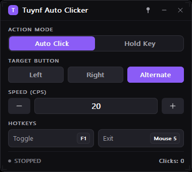
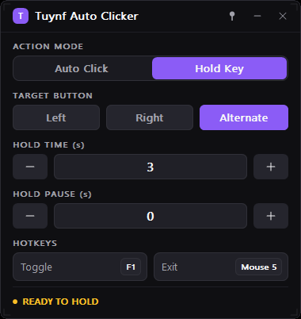

# Tuynf Auto Clicker

A compact Windows auto clicker with a custom dark UI, written from scratch in C++ using **Win32 + GDI+**. No Dear ImGui, no DirectX, no external UI framework.

<p align="center">
  
</p>

| Auto Click | Hold Key |
|:---:|:---:|
|  |  |

## Features

- **Two action modes** — Auto Click (repeated clicks) and Hold Key (press and hold for a duration).
- **Three targets** — Left, Right, or Alternate (alternates between Left and Right on each click).
- **Precise timing** — CPS 1–100, hold time 0.1–60 s, hold pause 0–60 s, driven by a high-resolution waitable timer without busy-waiting.
- **Rebindable hotkeys** — click a hotkey field and press any key, including Mouse 4/5. `Esc` cancels rebinding and duplicate keys are rejected.
- **Always on Top** — pin the window above other applications; the state is remembered between sessions.
- **Click counter and live status** — `STOPPED`, `RUNNING`, `READY TO HOLD`, `HOLDING`.
- **Custom window chrome** — borderless rounded window with a custom title bar and drag-to-move support.
- **Persistent settings** — mode, target, speed, hotkeys, Always on Top and window position.
- **High-DPI aware** — Per-Monitor V2 with DPI-scaled layout and fonts.
- **Efficient rendering** — reused 32-bpp back buffer, animations only while settling, timers stop when minimized.

## Defaults

| Setting | Default |
|---|---|
| Toggle hotkey | `F1` |
| Exit hotkey | `Mouse 5` |
| Target | Alternate |
| Click speed | 20 CPS |
| Hold time | 3 s |
| Hold pause | 0 s |

## Requirements

- Windows 10 or Windows 11 (x64)
- Visual Studio 2022 with **Desktop development with C++** (v143 toolset)
- Windows 10/11 SDK

## Build

Open `autoclick.sln` in Visual Studio 2022, select **Release | x64**, then build.

Or from a Developer Command Prompt:

```bat
msbuild autoclick.sln /p:Configuration=Release /p:Platform=x64
```

The executable is written to `x64\Release\autoclick.exe`.

## Usage

1. Choose **Auto Click** or **Hold Key**.
2. Pick the target: **Left**, **Right** or **Alternate**.
3. Adjust the value with the `-` / `+` buttons (hold to repeat) or click the number to type directly.
4. Press the toggle hotkey (default `F1`) to start or stop.
5. Press the exit hotkey (default `Mouse 5`) to close the application, or use the title-bar close button.
6. Click a hotkey chip and press a key to rebind it.

Settings are stored in:

```
%LOCALAPPDATA%\TuynfAutoClicker\settings.ini
```

If that location is unavailable, the application falls back to `settings.ini` next to the executable. Corrupt values are sanitized to safe defaults on load.

## Project structure

```
autoclick.sln
autoclick/
  autoclick.cpp          # full Win32 + GDI+ application
  autoclick.vcxproj
  autoclick.vcxproj.filters
  resource.h
  autoclick.rc
  icon_app.ico
docs/
  screenshot-auto.png
  screenshot-hold.png
  app-icon.png
```

## Notes

- Mouse input is injected with `SendInput`.
- Windows blocks synthetic input targeted at elevated applications unless this application is also run as administrator.
- The application is fixed-size by design: 380×341 DIP in Auto Click mode and 380×402 DIP in Hold Key mode.
- The maximize button is intentionally omitted; its title-bar slot is used by the Always on Top pin.

## License

No license has been chosen yet. All rights reserved by the author.
